


 

**[About](#about)** &nbsp;·&nbsp; **[Expertise](#expertise)** &nbsp;·&nbsp; **[Work](#work)** &nbsp;·&nbsp; **[Process](#process)** &nbsp;·&nbsp; **[Stack](#stack)** &nbsp;·&nbsp; **[Contact](#contact)**

 



**AHMII Labs** is an AI, web & software studio founded by **[Ahmad Naveed](https://ahmiilabs.netlify.app/about)**, a young builder from Pakistan.
One studio designs, builds and ships your website, AI platform or SaaS — **from first commit to live product.**

> *Engineered with AI. Directed by people.*
> Intelligent tooling wherever it helps, and a person accountable for every decision.

| | |
|:--|:--|
| **Studio** | AHMII Labs |
| **Founder** | Ahmad Naveed |
| **Based in** | Pakistan 🇵🇰 |
| **Focus** | AI · Web · Software · Games & 3D |
| **Status** | 🟢 Now booking new projects |




<table>
<tr>
<td width="50%"></td>
<td width="50%"></td>
</tr>
<tr>
<td width="50%"></td>
<td width="50%"></td>
</tr>
<tr>
<td width="50%"></td>
<td width="50%"></td>
</tr>
<tr>
<td width="50%"></td>
<td width="50%"></td>
</tr>
</table>

**Also shipped:** NexHouse · Visa CRM · NEX POS · developer toolkits
→ **[See every product & service on the website](https://ahmiilabs.netlify.app/products)**

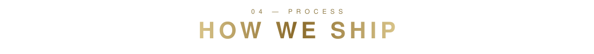





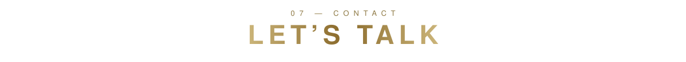

<a href="https://ahmiilabs.netlify.app/contact"></a>

| Channel | |
|:--|:--|
| 🌐 Website | [ahmiilabs.netlify.app](https://ahmiilabs.netlify.app/) |
| 💬 WhatsApp | [+92 306 8662727](https://wa.me/923068662727) · [Channel](https://whatsapp.com/channel/0029VbBHLvV17Emo4qu8SI2T) |
| ✈️ Telegram | [@Zeronex00](https://t.me/Zeronex00) |
| 🎮 Discord | `zeronex_55` |
| ✉️ Email | [ahmiilabs@gmail.com](mailto:ahmiilabs@gmail.com) |
| 📸 Instagram | [@ahmii_labs](https://instagram.com/ahmii_labs) · [@code_with_nex01](https://instagram.com/code_with_nex01) |
| 🎵 TikTok | [@ahmii_labs1](https://www.tiktok.com/@ahmii_labs1) |
| 🐙 GitHub | [@mrz3ron3x](https://github.com/mrz3ron3x) |

 

