 

**[About](#about)** &nbsp;·&nbsp; **[Expertise](#expertise)** &nbsp;·&nbsp; **[Work](#work)** &nbsp;·&nbsp; **[Process](#process)** &nbsp;·&nbsp; **[Stack](#stack)** &nbsp;·&nbsp; **[Contact](#contact)**

 

**AHMII Labs** is an AI, web & software studio founded by **[Ahmad Naveed](https://ahmiilabs.netlify.app/about)**, a young builder from Pakistan.
One studio designs, builds and ships your website, AI platform or SaaS — **from first commit to live product.**

> *Engineered with AI. Directed by people.*
> Intelligent tooling wherever it helps, and a person accountable for every decision.

| | |
|:--|:--|
| **Studio** | AHMII Labs |
| **Founder** | Ahmad Naveed |
| **Based in** | Pakistan |
| **Focus** | AI · Web · Software · Games & 3D |
| **Status** | 🟢 Now booking new projects |

<b>What each discipline includes</b>

 

| Discipline | What we deliver |
|:--|:--|
| 🌐 **Web** | Premium sites, landing pages, dashboards, e-commerce, responsive layouts, SEO-ready builds |
| 🤖 **AI** | Assistants and chatbots, LLM integration, agents, WhatsApp / Telegram bots, local models via Ollama |
| 💻 **Software** | SaaS, CRM and POS systems, internal tools, document tools, developer toolkits |
| 🎮 **Games & 3D** | Browser 3D worlds, product viewers, Three.js scenes, Remotion motion films |

 

<b>All projects</b>

 

<table>
<tr>
<td width="50%"></td>
<td width="50%"></td>
</tr>
<tr>
<td width="50%"></td>
<td width="50%"></td>
</tr>
<tr>
<td width="50%"></td>
<td width="50%"></td>
</tr>
<tr>
<td width="50%"></td>
<td width="50%"></td>
</tr>
</table>

<b>Project quick facts</b>

 

| Project | Type | Built with |
|:--|:--|:--|
| NEX AI | AI platform | Open models, showcase site, live demo |
| NEX Ecosystem | WhatsApp bot + chat network | Full-stack, owner login with approvals |
| JARVIS Agent House | Agent system | LLM agents |
| NexPet | Desktop pet app | Desktop app |
| EDU-LINK Pakistan | Education platform | Web |
| FFW Central Block | Browser 3D game | Three.js / WebGL, single HTML file |
| PDF & Document Suite | 10 tools | Web tools |
| AI Motion Film | 7-minute film, 1080p @ 30 FPS | Remotion + Three.js |

**Also shipped:** NexHouse · Visa CRM · NEX POS · developer toolkits
→ **[See every product & service on the website](https://ahmiilabs.netlify.app/products)**

<b>Start a project — what to send us</b>

 

1. What you want built (website, AI tool, app, game or 3D)
2. Who it is for and what it should do
3. References you like, and any deadline
4. Your preferred channel: WhatsApp, Telegram or email

Send this to any channel in the contact table below and we will reply with a plan.

| Channel | |
|:--|:--|
| 🌐 Website | [ahmiilabs.netlify.app](https://ahmiilabs.netlify.app/) |
| 💬 WhatsApp | [+92 306 8662727](https://wa.me/923068662727) · [Channel](https://whatsapp.com/channel/0029VbBHLvV17Emo4qu8SI2T) |
| ✈️ Telegram | [@Zeronex00](https://t.me/Zeronex00) |
| 🎮 Discord | `zeronex_55` |
| ✉️ Email | [ahmiilabs@gmail.com](mailto:ahmiilabs@gmail.com) |
| 📸 Instagram | [@ahmii_labs](https://instagram.com/ahmii_labs) · [@code_with_nex01](https://instagram.com/code_with_nex01) |
| 🎵 TikTok | [@ahmii_labs1](https://www.tiktok.com/@ahmii_labs1) |
| 🐙 GitHub | [@ahmiilabs](https://github.com/ahmiilabs) |

 

